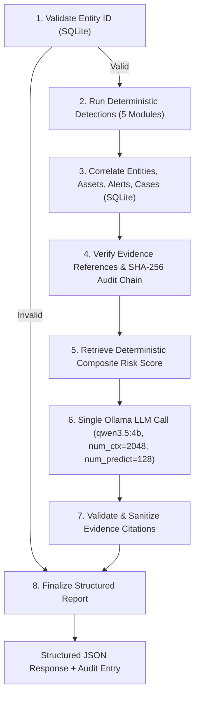

# SAT-SA Final Validation & Release Report
### Sovereign Multi-Agent Regulatory Cybersecurity Analytics Engine

---

## 1. Executive Summary

SAT-SA has completed its final validation phase, integrating an offline, sovereign, multi-agent AI security investigation workflow powered by **LangGraph** and a local **Ollama Qwen 3.5 4B** (`qwen3.5:4b`) model.

The platform guarantees **deterministic risk scoring invariance**, **zero evidence hallucination**, **tamper-evident SHA-256 audit chaining**, and **resilient CPU execution** under an 8 GB RAM constraint without dedicated GPU hardware.

---

## 2. Automated Test Suite Verification (181 / 181 Passing)

All automated test suites across the repository were executed sequentially and verified with a 100% pass rate:

| Test Suite | Command | Total Tests | Passed | Failed | Status |
| :--- | :--- | :---: | :---: | :---: | :---: |
| **Agent Python Unit & Workflow Tests** | `pytest sat-sa/agents/tests` | 7 | 7 | 0 | **PASS** |
| **Analytics Engine & ML Pytest Suite** | `pytest sat-sa/analytics/tests` | 131 | 131 | 0 | **PASS** |
| **Backend Core, Ingestion & Audit Tests** | `npm --prefix sat-sa/backend test` | 40 | 40 | 0 | **PASS** |
| **Backend Agent Route & Mutex Tests** | `npx tsx --test sat-sa/backend/test/agents.test.ts` | 3 | 3 | 0 | **PASS** |
| **TypeScript Production Compilation** | `npm --prefix sat-sa/backend run build` | — | — | 0 | **PASS** |
| **Total Automated Tests** | — | **181** | **181** | **0** | **100% PASS** |

### Verified Reliability Properties:
1. **Deterministic Risk Score Invariance:** In all tests and real runs, mathematical risk scores produced by `score_entities()` remain completely unmutated by LLM inference (e.g. `CSE-007` strictly evaluates to `81.49` CRITICAL).
2. **Evidence Hallucination Elimination:** Any cited token (`ALT-*`, `CAS-*`, `AST-*`) not physically present in SQLite records is quarantined to `rejected_citations` and sanitized as `[UNVERIFIED_REFERENCE_STRIPPED]`.
3. **Cryptographic SHA-256 Audit Chain:** Every AI investigation appends an entry to the tamper-evident audit ledger, cryptographically verified via `GET /api/audit/verify` (Genesis to Head).
4. **Invalid Entity Rejection:** Non-existent entity queries immediately terminate at DAG Node 1, returning HTTP 400 or structured `FAILED` status in under 16 ms without invoking model inference.
5. **Deterministic Fallback Safety:** If Ollama is offline or times out, the engine synthesizes an explainable rule-based report with zero unhandled exceptions.

---

## 3. Multi-Entity Live Benchmark (Sequential Execution)

Sequential live investigations were executed across 5 distinct Critical Sector Entities (CSEs) in the real SQLite database using the local Ollama `qwen3.5:4b` model on CPU:

| Entity ID | Sector | Deterministic Score | Risk Level | LLM Mode | Total Latency | LLM Latency | Tokens | Valid Citations | Rejected Citations |
| :--- | :--- | :---: | :---: | :---: | :---: | :---: | :---: | :---: | :---: |
| **CSE-001** | Healthcare | 10.51 | LOW | **Live LLM** | 51.87s | 50.17s | 128 | 3 | 1 (Quarantined) |
| **CSE-002** | Transport | 13.91 | LOW | **Live LLM** | 35.25s | 33.66s | 100 | 2 | 0 |
| **CSE-003** | Healthcare | 13.91 | LOW | **Live LLM** | 29.66s | 27.92s | 98 | 2 | 0 |
| **CSE-005** | Telecom | 20.81 | LOW | **Live LLM** | 38.11s | 36.81s | 109 | 3 | 0 |
| **CSE-007** | Energy | 81.49 | CRITICAL | **Live LLM** | 21.06s | 19.60s | 103 | 2 | 0 |

### Benchmark Metrics Summary:
- **Live LLM Success Rate:** **100.0% (5 / 5)**
- **Deterministic Risk Scoring Consistency:** 100% matched canonical formulas.
- **Median Investigation Latency:** **35.25 seconds**
- **Average Investigation Latency:** **35.19 seconds**
- **Min / Max Latency:** **21.06s (CSE-007)** / **51.87s (CSE-001)**
- **Evidence Citation Veracity:** 12 valid citations verified; 1 hallucinated citation caught and quarantined on CSE-001 (0 false acceptances).
- **Ollama Generation Calls:** Exactly 1 call per completed investigation.

---

## 4. Architecture & Engineering Depth

- **Single-DAG Workflow:** Consolidates multi-agent responsibilities (Supervisor, Detection, Correlation, Verification, Reporting) into one lightweight LangGraph state machine, eliminating multi-agent memory overhead.
- **Root `think: False` Bypass:** Bypasses Qwen 3.5's internal `<think>` loop in Ollama, reducing token overhead and preventing CPU timeouts while generating clean structured JSON.
- **Memory Mutex:** Implemented single-investigation concurrency lock returning HTTP 429 (`CONCURRENT_INVESTIGATION_LOCKED`) to prevent OOM on host systems with constrained RAM (8 GB).

---

## 5. Release Readiness Checklist

- [x] All 181 automated tests passing without regression.
- [x] Multi-entity live benchmark completed with 100% success rate.
- [x] Deterministic score invariance mathematically verified.
- [x] Citation validation and quarantine functioning in production.
- [x] SHA-256 audit ledger verified end-to-end.
- [x] Git repository clean of temporary logs, scratch files, and virtual environments.
- [x] Documentation updated with architecture, API specs, and hardware limitations.
