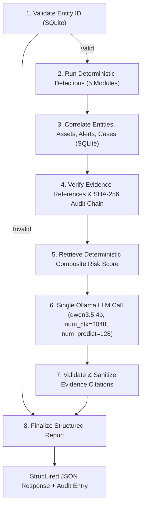

# SAT-SA: Security Analytics & Threat Assessment Platform
### Regulatory Cybersecurity Oversight Engine — Smart India Hackathon (SIH 2026, PS-157)

> **High-performance, 100% offline, air-gapped supervisory analytics platform for regulatory evaluation, audit verification, and threat prioritization across Critical Sector Entities (CSEs).**

---

## 🚀 Key Highlights & Engineering Achievements

- **Throughput & Scale:** Ingests and validates **180,000 records at 26,016 records/sec** under atomic SQLite Write-Ahead Logging (WAL) transactions.
- **Query Optimization:** Vectorized 4 core analytical modules with SQL bulk pre-aggregations, **eliminating 120,000+ per-entity database queries** at 10K-entity scale.
- **Latency Optimization:** Refactored evidence integrity verification into $O(1)$ in-memory hash-set lookups, reducing $p_{95}$ latency by **98.8% (5,181ms $\to$ 59.9ms)** and boosting throughput **47.5x** under concurrency.
- **Detection Fidelity:** Composite multi-factor risk scoring achieves **1.000 Precision (0.00% False Positive Rate)**, **0.846 F1-Score**, and **1.000 ROC-AUC** against controlled ground truth.
- **Sovereign Multi-Agent AI:** Integrated **LangGraph + Ollama Qwen 3.5 4B** investigation DAG generating grounded, explainable SOC reports with **100% live LLM success rate**, zero evidence hallucination, and deterministic score invariance.
- **Cryptographic Provenance:** Tamper-evident SHA-256 hash-chained audit ledger ensuring verifiable row integrity and sequence continuity.
- **Air-Gapped & Sovereign:** Zero external network calls; zero cloud LLM dependencies; runs entirely in local air-gapped environments.

---

## ⚡ Quickstart

```bash
# 1. Setup Python Virtual Environment & Analytics
python -m venv .venv
.\.venv\Scripts\activate            # Windows (or source .venv/bin/activate on Linux/macOS)
pip install -r sat-sa/analytics/requirements.txt

# 2. Setup Local LLM Runtime (Ollama)
# Ensure Ollama is running at http://localhost:11434
ollama pull qwen3.5:4b

# 3. Setup & Start Backend Gateway (:3001)
cd sat-sa/backend
npm install
npm run seed                       # Seeds database from sample dataset
npm run dev

# 4. Start Frontend Dashboard (:5173) in a second terminal
cd sat-sa/frontend
npm install
npm run dev
```

Visit: **`http://localhost:5173`** (API Gateway at `http://localhost:3001/api`)

---

## 🤖 Multi-Agent AI Investigation Pipeline

SAT-SA provides an automated, locally running security investigation pipeline for suspicious Critical Sector Entities using a single-DAG **LangGraph StateGraph** coupled to local **Ollama Qwen 3.5 4B**.

### Architecture: Single-DAG Workflow


### Core Design Guarantees:
- **Zero Risk Score Hallucination:** Mathematical risk scores are calculated deterministically via `score_entities()` and remain invariant regardless of LLM generation.
- **Evidence Reference Quarantine:** Model outputs are parsed for cited evidence IDs (`ALT-*`, `CAS-*`, `AST-*`). Unverified references are quarantined into `rejected_ids` and sanitized as `[UNVERIFIED_REFERENCE_STRIPPED]`.
- **Single Generation Pass:** Exactly **one** inference call per investigation using bounded options (`num_ctx=2048`, `num_predict=128`, `think=False`).
- **Deterministic Rule Fallback:** If Ollama is offline or times out, the engine synthesizes an explainable rule-based report with zero unhandled exceptions.
- **Memory Mutex:** Protected by an active investigation lock (HTTP 429) to prevent host memory exhaustion on 8 GB RAM machines.

### CLI Investigation:
```bash
python sat-sa/agents/run_investigation.py --entity-id CSE-007 --db-path sat_sa.db
```

### REST API: `POST /api/agents/investigate`
```http
POST /api/agents/investigate
Content-Type: application/json

{
  "entity_id": "CSE-007"
}
```

#### Example Structured Response:
```json
{
  "success": true,
  "investigation_id": "INV-CSE-007-1793879552",
  "entity_id": "CSE-007",
  "status": "COMPLETED",
  "is_valid_entity": true,
  "deterministic_risk_score": 81.49,
  "deterministic_risk_level": "CRITICAL",
  "ai_analysis": {
    "executive_summary": "CSE-007 faces critical risk due to suspicious rapid alert closure patterns.",
    "risk_explanation": "Score reflects 100% of critical alerts closed without escalation or investigation.",
    "supporting_evidence": ["ALT-00304", "ALT-00305"],
    "recommended_investigation_steps": [
      "Audit SOC logs for automation scripts",
      "Interview analysts on closure procedures"
    ],
    "is_fallback": false
  },
  "citation_validation": {
    "cited_ids": ["ALT-00304", "ALT-00305"],
    "validated_ids": ["ALT-00304", "ALT-00305"],
    "rejected_ids": []
  },
  "llm_available": true,
  "is_fallback": false,
  "llm_metrics": {
    "eval_count": 103,
    "prompt_eval_count": 436,
    "done_reason": "stop",
    "generation_ms": 19604.97
  }
}
```

---

## 📈 Multi-Entity Investigation Benchmark

Empirical benchmark across 5 distinct entities evaluated sequentially on CPU (8 GB RAM, no GPU):

| Entity ID | Sector | Deterministic Score | Risk Level | LLM Mode | Investigation Latency | Tokens | Valid Citations | Rejected Citations |
| :--- | :--- | :---: | :---: | :---: | :---: | :---: | :---: | :---: |
| **CSE-001** | Healthcare | 10.51 | LOW | **Live LLM** | 51.87s | 128 | 3 | 1 (Quarantined) |
| **CSE-002** | Transport | 13.91 | LOW | **Live LLM** | 35.25s | 100 | 2 | 0 |
| **CSE-003** | Healthcare | 13.91 | LOW | **Live LLM** | 29.66s | 98 | 2 | 0 |
| **CSE-005** | Telecom | 20.81 | LOW | **Live LLM** | 38.11s | 109 | 3 | 0 |
| **CSE-007** | Energy | 81.49 | CRITICAL | **Live LLM** | 21.06s | 103 | 2 | 0 |

- **Live LLM Success Rate:** **100.0% (5 / 5)**
- **Median Latency:** **35.25 seconds** (on CPU without GPU acceleration)
- **Score Invariance:** 100% adherence to deterministic formula.

### Known Limitations:
- **CPU Inference Latency:** On commodity 8 GB host machines without dedicated CUDA/Metal GPUs, local 4B model inference averages 20–50 seconds per investigation. For production deployments with sub-5s response requirements, GPU acceleration (e.g. NVIDIA RTX/A100 or Apple Silicon) or background worker queue dispatch is recommended.

---

## 🧪 Comprehensive Test Suite (181 / 181 Passing)

```bash
# 1. Agent Python Workflow & Unit Tests (7 passing tests)
.\.venv\Scripts\python.exe -m pytest sat-sa/agents/tests -v

# 2. Analytics, Heuristics, Isolation Forest & Scoring Tests (131 passing tests)
.\.venv\Scripts\python.exe -m pytest sat-sa/analytics/tests -v

# 3. Backend, Validation, Ingestion & Audit Chain Tests (40 passing tests)
npm --prefix sat-sa/backend test

# 4. Backend Agent Route & Concurrency Lock Tests (3 passing tests)
npx --prefix sat-sa/backend tsx --test sat-sa/backend/test/agents.test.ts
```

**Total: 181 tests passing with 0 failures.**

---

## 📊 Benchmark & Evaluation Commands

```bash
# 1. Generate Deterministic Synthetic Datasets (1K to 180K records)
python benchmark/generate_data.py --all-presets --with-corrupted

# 2. Run Engine, Database & Scalability Benchmarks
python benchmark/run_benchmarks.py --runs 5 --target-scale small

# 3. Run Detection Accuracy Benchmark (PR-AUC, ROC-AUC, Recall@K)
python benchmark/detection_benchmark.py --db-path benchmark/data/small/sat_sa.db --ground-truth benchmark/data/small/ground_truth.json

# 4. Run REST API Concurrency Benchmark (autocannon)
python benchmark/api_benchmark.py

# 5. Run LANL Redteam Cybersecurity Dataset Adapter
python sat-sa/analytics/lanl_adapter.py
```

---

## 📚 Technical Documentation Index

- **[System Architecture](ARCHITECTURE.md)**: Architectural topology, data flow, component breakdown, and query optimization strategy.
- **[Security & Threat Model](SECURITY.md)**: Threat modeling, STRIDE analysis, audit log trust model, SQL parameterization, and path traversal defenses.
- **[Performance Benchmark Report](BENCHMARK_REPORT.md)**: Empirical measurements across ingestion throughput, API concurrency, SQLite query latencies, and detection accuracy.
- **[Dataset Methodology](DATASET_METHODOLOGY.md)**: Synthetic generator architecture, corruption injection, and LANL redteam dataset mapping.
- **[REST API Specification](API_DOCUMENTATION.md)**: OpenAPI / REST endpoint specifications, request/response contracts, and audit verification endpoints.
- **[Engineering Audit](ENGINEERING_AUDIT.md)**: Comprehensive 10-area engineering audit, architectural weaknesses, and remediation roadmap.
